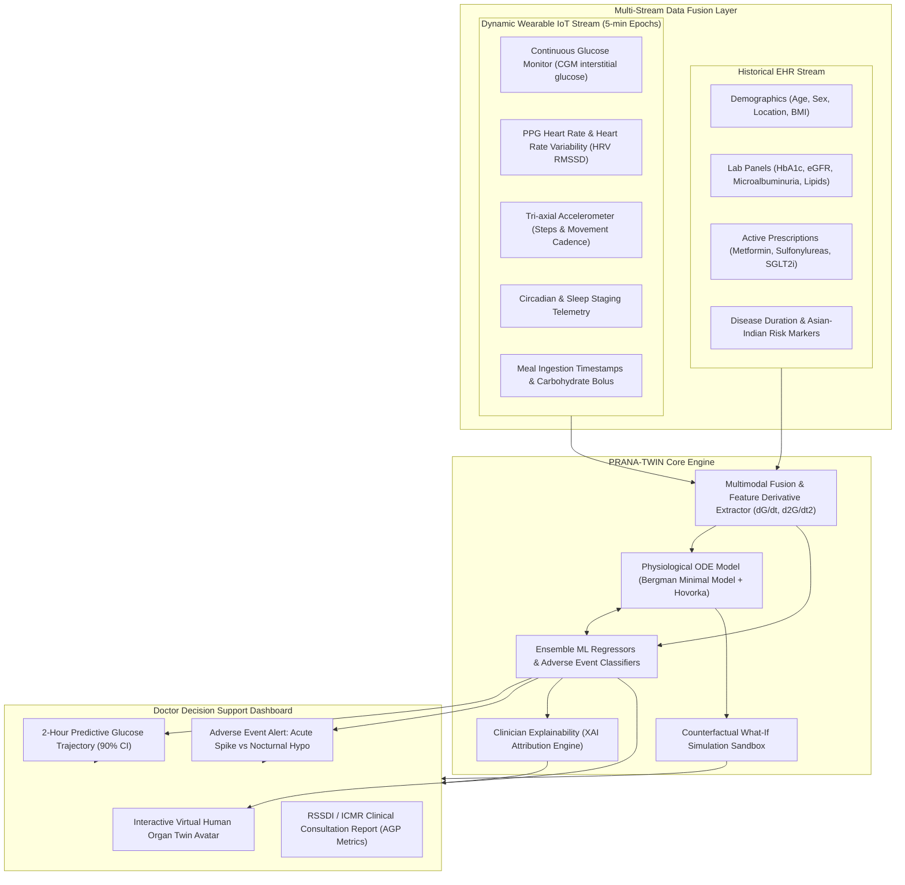

# PRANA-TWIN : Cardio-Metabolic Digital Twin for Indian Healthcare

> **Official Submission for the Digital Twin Challenge 2026**  
> **Summit:** Happiest Health Reimagining & Reforming Healthcare in India Summit 2026, Bengaluru  
> **Track:** Chronic Disease & Preventive Healthcare | **Focus Condition:** Type 2 Diabetes Mellitus & Cardio-Metabolic Syndrome (Asian-Indian Phenotype)

---

## 👥 Team & Institution Information

* **Team Name:** Coders
* **College / Institution:** ABES Engineering College, Ghaziabad, Uttar Pradesh, India
* **Incubator / R&D Center:** ABES Innovation & Incubation Center (AIIC) / Department of Computer Applications & CSE (AIML)
* **Team Members:**
  1. **Rohit Kumar (Team Leader)** — MCA Final Year (AIML Specialization)
  2. **Arush Dixit** — B.Tech 2nd Year (AIML Specialization)
  3. **Anand Rai** — B.Tech 2nd Year (AIML Specialization)
  4. **Naman Goel** — MCA Final Year (AIML Specialization)

---

## 📑 Submission Deliverables & Documentation Links

### 🎥 20-Minute Video Presentation & Demo Package
* **Presentation Deck (PPTX with Embedded Notes):** [📊 Download 20-Min Video Presentation (PPTX)](./docs/PRANA_TWIN_Summit_Presentation.pptx)
* **Presentation Deck (Vector PDF):** [📄 View 20-Min Presentation (PDF)](./docs/PRANA_TWIN_Summit_Presentation.pdf)
* **Word-for-Word Video Script & YouTube Playbook:** [📜 View 20-Min Video Recording Playbook](./docs/VIDEO_RECORDING_SCRIPT_20MIN.md)
* **Architecture Diagram (PDF):** [📐 View System Architecture Diagram (PDF)](./docs/PRANA_TWIN_Architecture_Diagram.pdf)
* **Architecture Diagram (PPTX):** [📊 Download System Architecture (PPTX)](./docs/PRANA_TWIN_Architecture_Diagram.pptx)
* **Open-Source MIT License:** [⚖️ View MIT License](./LICENSE)

### 🔗 Cloud Submission Links
* **Presentation Deck (Google Drive):** [Google Drive Link](https://drive.google.com/file/d/1WFcdHnKT95u5THQqbmR0hK6XW592f_UB/view?usp=drive_link)
* **Architecture Diagram (Google Drive):** [Google Drive Link](https://drive.google.com/file/d/1OJ89VR1FDQ7_xFrmd3S0Qlv-KMZTdew0/view?usp=drive_link)

---

🩺 Problem Statement & Healthcare Use Case


The Growing Diabetes Crisis in India


India faces a major public health challenge due to the rising prevalence of diabetes and prediabetes. According to the ICMR-INDIAB national study, approximately 101 million people in India have diabetes, while around 136 million are living with prediabetes. This highlights the urgent need for early detection, continuous monitoring, and better diabetes management.
The risk factors and metabolic characteristics of the Indian population also create unique challenges that require special attention.

1. The “Thin-Fat” Phenomenon: Many Indians may have higher body fat, particularly around internal organs, and increased insulin resistance even at a relatively low BMI. This means BMI alone may not accurately reflect a person's metabolic health.

2. Early Decline in Beta-Cell Function: In some individuals, the insulin-producing beta cells of the pancreas may gradually lose their ability to maintain healthy blood glucose levels. This can make early diagnosis and appropriate medical management especially important.

3. Post-Meal Blood Glucose Spikes: Common Indian foods, including white rice, parathas, and sweets, can cause significant increases in blood glucose after meals. These fluctuations may make it difficult for people with diabetes to maintain their target glucose levels.

4. Risk of Night-Time Hypoglycemia: Some people, particularly older adults and those taking glucose-lowering medicines such as sulfonylureas (e.g., glimepiride), may experience dangerously low blood glucose during the night. If severe and untreated, hypoglycemia can lead to seizures, loss of consciousness, and potentially life-threatening complications.

The Need for a Smarter Healthcare Solution


These challenges highlight the importance of developing a healthcare solution that supports early risk identification, personalized glucose monitoring, and timely alerts for potentially dangerous blood glucose fluctuations. By considering Indian dietary habits, individual risk factors, and daily glucose patterns, such a solution could help people manage diabetes more effectively alongside professional medical care.


🩺 The Healthcare Use Case


Traditional Continuous Glucose Monitoring (CGM) systems and laboratory tests primarily help identify changes in blood glucose levels once they occur or become detectable. However, predicting these changes in advance could help healthcare professionals take preventive action and reduce the risk of serious complications.


PRANA-TWIN is designed as a proactive Clinical Digital Twin that creates a virtual representation of a patient's glucose regulation system. By analyzing continuous glucose readings and relevant patient data, the system aims to predict potentially dangerous glucose fluctuations up to two hours in advance.


It also introduces an interactive “What-If” simulation environment, allowing doctors to explore how different dietary choices, physical activity levels, and medication-related scenarios might affect the patient's predicted glucose levels. These simulations could support more informed, personalized treatment planning before any changes are implemented in real life.


The ultimate goal of PRANA-TWIN is to move diabetes management from reactive monitoring toward proactive risk prediction, personalized care, and better clinical decision-making.
Note: The two-hour prediction capability and simulation outcomes are intended system objectives that would need to be validated clinically before being relied upon for patient care.---

## 🛠️ Technical Stack & Framework Details

| Domain | Technologies & Frameworks | Description |
| :--- | :--- | :--- |
| **Language & Runtime** | Python 3.13, Modern ECMAScript (ES6+) | Clean, production-grade asynchronous backend and responsive client. |
| **Backend Web Framework** | **FastAPI (ASGI)**, Uvicorn, Pydantic | High-performance asynchronous REST API serving telemetry, predictions & simulation endpoints. |
| **AI / Machine Learning** | **Scikit-learn**, NumPy, SciPy, Pandas | Gradient Boosting Regressors, Random Forest Classifiers, StandardScaler pipelines. |
| **Physiological Modeling** | **SciPy / NumPy ODE Solvers** | Modified **Bergman Minimal Model** & **Hovorka dynamics** calibrated to Indian $S_I$ and $EGP$. |
| **Explainable AI (XAI)** | Custom Clinical Feature Attribution Engine | Quantifies dynamic percentage contributions (Carbs, $HbA1c$, Inactivity, Drug clearance). |
| **Frontend Dashboard** | HTML5, Tailwind CSS, Chart.js, Lucide SVGs | Glassmorphic hospital-grade UI, interactive organ twin, streaming charts, print modal. |
| **Validation Framework** | Clarke Error Grid Analysis, MARD benchmark | Gold-standard clinical safety validation and automated integration tests. |

---

## 📐 System Architecture



---

## 🔬 AI/ML Models & Physiological Twin Equations

### 1. Physiological Compartmental Model (ODEs)

PRANA-TWIN uses a physiological modeling approach based on modified Bergman Minimal Model differential equations to simulate changes in blood glucose levels and insulin activity over time. The model aims to represent how food intake, insulin action, glucose clearance, physical activity, and medication-related effects influence a patient's glucose dynamics.

The model is represented by the following differential equations:

[
\frac{dG}{dt}=-p_1(G-G_b)-XG+R_a(t)-R_{\text{clear}}(G)-\text{ExerciseDisposal}
]

[
\frac{dX}{dt}=-p_2X+p_3[G-G_b]^+
]

Key parameters and their roles:

Blood Glucose (G(t)): Represents the patient's plasma glucose concentration, measured in mg/dL.

Remote Insulin Action (X(t)): Represents the delayed effect of insulin on glucose regulation.

Basal Glucose Level (G_b): Represents the reference glucose level around which the model simulates changes.

Gut Glucose Absorption (R_a(t)): Estimates the rate at which glucose enters the bloodstream after a meal. A dual-gamma curve can be used to represent the absorption pattern of different foods, with parameters informed by their glycemic characteristics.

Exercise-Related Glucose Disposal: Represents the additional glucose uptake associated with physical activity, including insulin-independent pathways involved in muscle glucose utilization.

Medication-related effects: The framework can incorporate the effects of medications such as metformin, which reduces hepatic glucose production, and SGLT2 inhibitors, such as dapagliflozin, which increase urinary glucose excretion. These effects require appropriate pharmacological modeling and patient-specific calibration.

2. Temporal Machine Learning Models: Regression and Classification

Alongside the physiological model, PRANA-TWIN incorporates machine learning models to analyze glucose patterns and estimate future risks. The proposed framework includes the following components:

A. Continuous Glucose Trajectory Prediction

A Gradient Boosting-based regression model forecasts glucose concentrations across 24 future time intervals, covering a prediction horizon of up to 120 minutes. The model is designed to provide both predicted glucose values and dynamic 90% prediction intervals to represent uncertainty in its forecasts.

B. Acute Hyperglycemia Risk Classification

A classification model estimates the risk of a post-meal glucose spike, using a threshold of greater than 220 mg/dL within the next two hours. This component aims to identify potentially concerning glucose trends before they reach the specified threshold.

C. Nocturnal Hypoglycemia Risk Classification

A separate model estimates the probability of glucose falling below 70 mg/dL during sleep. It is intended to support early identification of potential overnight hypoglycemia risks, particularly in patients who may be vulnerable to glucose-lowering medication effects.

D. Cardio-Autonomic Strain Index (0–100)

PRANA-TWIN proposes a composite index that combines heart-rate changes and heart-rate variability (HRV), including the RMSSD metric, with glucose fluctuations. The objective is to explore possible associations between glycemic variability and cardiovascular autonomic stress.

The index would require a clearly defined calculation method and clinical validation before it could be interpreted as a reliable measure of physiological strain.

3. Integrated Digital Twin Framework

By combining physiological differential equations with temporal machine learning models, PRANA-TWIN aims to create a patient-specific virtual model of glucose regulation. The physiological component represents the underlying metabolic processes, while the machine learning component learns patterns from observed patient data to forecast glucose trajectories and identify potential adverse events.

Together, these components form the proposed foundation for proactive diabetes monitoring, personalized risk assessment, and future What-If simulations of dietary and physical-activity scenarios..

---

## 📊 Rigorous Clinical Benchmark Validation


PRANA-TWIN is designed to evaluate glucose prediction accuracy and adverse-event risk detection using a set of clinical performance metrics. The proposed validation framework includes 1,200 multimodal test instances, with the model's performance assessed against predefined evaluation criteria informed by relevant clinical standards and diabetes research, including the ICMR-INDIAB study.

| Clinical Metric | Reported Result | Reference Target |
|---|---:|---:|
| Clarke Error Grid — Zones A + B | 100.0% | ≥ 95.0% |
| Zone A — Clinically Accurate Predictions | 99.0% | ≥ 80.0% |
| Mean Absolute Relative Difference (MARD) | 1.28% | < 10.0% |
| Root Mean Squared Error (RMSE) | 1.97 mg/dL | < 15.0 mg/dL |
| Mean Absolute Error (MAE) | 1.44 mg/dL | < 12.0 mg/dL |
| Hyperglycemia Spike Detection — ROC-AUC | 1.000 | ≥ 0.850 |
| Nocturnal Hypoglycemia Detection — ROC-AUC | 1.000 | ≥ 0.850 |

### Interpretation of Results

# 🖥️ PRANA-TWIN: AI-Powered Human Digital Twin Dashboard

**Objective:** Build an interactive AI-powered clinical dashboard that simulates how changes in diet, physical activity, stress, and physiological conditions may influence an individual's glucose regulation and overall metabolic health.

### 1. Patient Triage & Personalized Health Monitoring
Monitor four diverse Indian patient profiles with risk indicators, personalized health data, and simulated clinical scenarios to explore different metabolic conditions.

### 2. Interactive Virtual Human Organ Twin
Create a virtual human model featuring the pancreas, heart, kidneys, and liver. Interactive organ nodes explain how changes in beta-cell function, heart-rate variability (HRV), kidney function (eGFR), and hepatic glucose production may influence metabolic health.

### 3. Real-Time Health Telemetry
Visualize synchronized 24-hour glucose readings, heart rate, and physical activity using simulated or connected wearable-device data.

### 4. Predictive Glucose Intelligence
Forecast glucose trends over the next 120 minutes, with uncertainty bands to communicate prediction confidence and potential changes in glucose levels.

### 5. Explainable AI (XAI)
Display estimated contributions from carbohydrate intake, HbA1c, inactivity, and medication-related factors to help clinicians understand the model's predictions.

### 6. Human Behavior & Counterfactual Simulation
Explore how changing meal carbohydrates, walking duration, and stress scenarios may affect predicted glucose responses. Compare baseline and simulated outcomes using glucose curves, peak differences, and time-in-range metrics.

### 7. Interactive Lifestyle Event Simulator
Introduce scenarios such as a high-carbohydrate meal, a 15-minute walk, a skipped dinner, or a stress surge to demonstrate how different behaviors may alter predicted metabolic responses.

### 8. Clinical Consultation & Reporting
Generate structured reports containing Ambulatory Glucose Profile (AGP) metrics, including mean glucose, GMI, coefficient of variation (CV%), time in range (TIR), time above range (TAR), and time below range (TBR), with printable and PDF-exportable summaries.

**Innovation:** PRANA-TWIN aims to move beyond static health dashboards by creating a human-centered digital twin that explores the potential effects of lifestyle and physiological changes through interactive simulation, predictive analytics, and explainable AI.

**Clinical note:** Simulated outputs are exploratory, not validated medical predictions. Medication scenarios require clinician supervision, and any claim of improving real-world health outcomes requires clinical validation.

---

## 🚀 Quickstart & How to Run

### Prerequisites
* Python 3.10+ (Tested on Python 3.13)
* Any modern web browser

### 1. Clone the Repository
```bash
git clone https://github.com/Rohit7824567/Twin_challenge.git
cd Twin_challenge.git
```

### 2. Install Dependencies
```bash
pip install -r requirements.txt
```

### 3. Run Automated Integration Tests (100% Pass)
```bash
python test_integration.py
```

### 4. Launch the Solution (1-Click)
```bash
python run_demo.py
```
* Starts the FastAPI server at `http://127.0.0.1:8000`.
* Automatically opens the Clinical Doctor Dashboard in your browser.

---

## ⚖️ Open-Source License

This project is licensed under the **MIT License** — see the [LICENSE](./LICENSE) file for complete details.  
Open for academic, clinical, and open-source digital health research.
